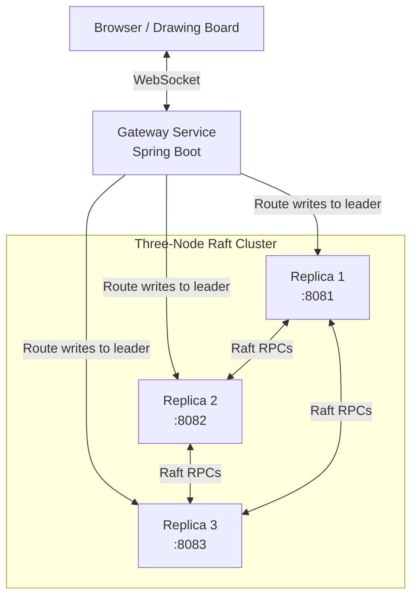

# Raft Implementation — Distributed Collaborative Drawing Board

A real-time collaborative drawing board powered by a **custom Raft consensus engine implemented from scratch in Java**. The system uses leader election, replicated logs, majority-based commits, persistent storage, and replica recovery to coordinate drawing updates across a three-node cluster.

**Built from scratch. No Raft libraries. Hands-on distributed systems engineering.**

<p align="center">
  
  
  
  
</p>

---

## Overview

Raft is a consensus algorithm that enables distributed nodes to agree on an ordered sequence of operations, even when individual nodes become unavailable.

This project implements the core Raft mechanisms and integrates them into a collaborative drawing application. Instead of treating consensus as an isolated algorithm, it uses replicated log entries to coordinate actual drawing updates.

### How it works

1. **Submit a stroke** — The browser sends a drawing event through the gateway.
2. **Find the leader** — The gateway routes the write to the current Raft leader.
3. **Replicate the entry** — The leader appends the operation to its log and replicates it to followers.
4. **Commit by majority** — The entry is committed when the required majority acknowledges it.
5. **Recover and catch up** — If a replica goes offline, it can rejoin and synchronize missed entries.

The cluster contains three replicas and requires a quorum of two nodes to commit new entries.

---

## Architecture



### Core components

| Component | Responsibility |
|---|---|
| Frontend | Drawing canvas and user interactions |
| Gateway | Receives drawing events and routes writes |
| Raft node | Maintains the node's consensus state |
| Election service | Coordinates term-based elections and voting |
| Heartbeat service | Maintains leader contact with followers |
| Replication service | Sends log entries through `AppendEntries` |
| Commit service | Advances the commit index after acknowledgements |
| Log store | Persists Raft log entries |
| Node state store | Persists Raft node state |
| Sync controller | Supports synchronization of rejoining replicas |

---

## Features

### Consensus and replication

- Custom Raft implementation in Java.
- Leader election using randomized election timeouts and term-based voting.
- `RequestVote` and `AppendEntries` RPCs over HTTP.
- Majority-based log commitment.
- Log reconciliation to avoid duplicate appends and handle conflicting entries.
- Commit-index tracking across replicas.

### Persistence and recovery

- Persistent Raft log storage using Java properties files.
- Persistent node state, including term and voting information.
- Replica-specific Docker volumes for retaining data across container restarts.
- Catch-up synchronization for replicas that miss writes while offline.
- Recovery of a restarted replica into the running cluster.

### Application and deployment

- Real-time collaborative drawing interface.
- Spring Boot gateway and replica services.
- Docker-based deployment of a three-node cluster.
- Automated Maven tests through GitHub Actions.

---

## Validation and Test Results

The implementation has been tested with both automated tests and a live three-replica Docker cluster.

| Test scenario | Observed result |
|---|---|
| Automated replica tests | 15 tests passed locally |
| GitHub Actions | Successful workflow run on the tested commit |
| Initial log replication | All three replicas committed entry at index `0` |
| Replica restart | Previously committed entry survived restart |
| Replica downtime | Rejoining replica caught up to the latest committed entry |
| Leader failure | A remaining replica became the new leader |
| Write with original leader offline | Write committed with the two available replicas |
| Original leader recovery | All three replicas returned with matching committed logs |

### Example: replicated state

After submitting three drawing strokes during the integration tests, the replicas reported the following state:

| Replica | Role at final check | Last log index | Commit index |
|---|---|---:|---:|
| Replica 1 | Follower | 2 | 2 |
| Replica 2 | Follower | 2 | 2 |
| Replica 3 | Leader | 2 | 2 |

All three replicas had the same three log entries, indexed `0` through `2`, and reported commit index `2`.

*These are results from the scenarios exercised during testing, not a comprehensive benchmark or proof of correctness under every possible failure.*

---

## Tech Stack

| Layer | Technology |
|---|---|
| Language | Java |
| Backend services | Spring Boot |
| Consensus algorithm | Custom Raft implementation |
| Communication | HTTP-based Raft RPCs |
| Frontend | HTML, JavaScript, Canvas, WebSocket |
| Persistence | Java properties-based storage |
| Containerization | Docker and Docker Compose |
| Automated testing | Maven and GitHub Actions |

---

## Getting Started

### Prerequisites

- Docker Desktop or Docker Engine with Docker Compose.
- Git.
- Ports `3000`, `8080`, `8081`, `8082`, and `8083` available, as configured by the deployment.

### 1. Clone the repository

```bash
git clone https://github.com/Personal279/Raft-Implementation.git
cd Raft-Implementation
```

### 2. Start the application

From the directory containing `docker-compose.yml`:

```bash
docker compose up --build -d
```

Check the running containers:

```bash
docker compose ps
```

### 3. Open the drawing board

Open the frontend in your browser:

```text
http://localhost:3000
```

The gateway is exposed at:

```text
http://localhost:8080
```

The replica services use ports `8081`, `8082`, and `8083`.

### 4. Inspect replica state

The debug endpoints expose each node's identity, role, log index, log size, and commit index.

```bash
curl http://localhost:8081/raft/debug
curl http://localhost:8082/raft/debug
curl http://localhost:8083/raft/debug
```

Example response:

```json
{
  "nodeId": "node1",
  "role": "LEADER",
  "lastLogIndex": 2,
  "logSize": 3,
  "commitIndex": 2
}
```

The exact role and index values depend on the current cluster state.

---

## Failure Simulation

One of the most useful ways to explore the implementation is to stop a replica and observe how the remaining cluster behaves.

### Simulate a leader failure

Stop the container that currently hosts the leader. For example, if the leader is `replica2`:

```bash
docker stop replica2
```

Inspect the remaining replicas:

```bash
curl http://localhost:8081/raft/debug
curl http://localhost:8083/raft/debug
```

Observe the election process in the container logs:

```bash
docker logs replica1 --tail 50
docker logs replica3 --tail 50
```

With two nodes available in a three-node cluster, a majority remains available for committing writes.

### Restart the failed replica

```bash
docker start replica2
```

Inspect its state after it has started:

```bash
curl http://localhost:8082/raft/debug
docker logs replica2 --tail 50
```

Check whether the recovered replica has caught up with the committed log entries on the active cluster.

### Shut down the cluster

```bash
docker compose down
```

This stops and removes the Compose containers and network. Named volumes are retained unless explicitly removed.

---

## How Raft Is Implemented

### 1. Leader election

Each node maintains its current term and role: `FOLLOWER`, `CANDIDATE`, or `LEADER`.

When a follower does not receive valid leader communication within its election timeout, it can become a candidate, advance its term, and request votes from peers.

In a three-node cluster, a candidate needs two votes to obtain a majority.

### 2. Log replication

A drawing stroke is represented as a log entry.

The leader sends `AppendEntries` RPCs to followers. Followers reconcile incoming entries with their existing logs, and the leader advances its commit index when the required acknowledgements are obtained.

Committed entries represent operations accepted by the Raft cluster.

### 3. Persistent state

The implementation persists log entries and important node state using Java properties-based storage.

Docker volumes provide storage outside each container's writable layer, allowing replica data to survive ordinary container restarts.

Persistence across a container restart was verified during integration testing. Hard-crash durability and every possible storage failure have not been exhaustively tested.

### 4. Replica recovery

A node can become unavailable while the other two nodes continue committing entries.

When the missing node returns, synchronization allows it to catch up with the log. In the integration test, a replica missed a write while offline and subsequently returned with the same committed log index as the other replicas.

### 5. Failure handling

The implementation includes term checks, voting rules, log reconciliation, election timeout handling, and bounded HTTP RPC timeouts.

These mechanisms address important Raft failure scenarios, but full correctness under arbitrary network partitions, simultaneous failures, and all crash timings remains outside the scope of the tests performed so far.

---

## Project Structure

```text
Raft-Implementation/
├── frontend/
│   ├── index.html
│   ├── canvas.js
│   └── websocket.js
│
├── gateway/
│   └── src/main/java/com/draw/gateway/
│       ├── model/
│       │   └── StrokeEvent.java
│       ├── service/
│       ├── websocket/
│       │   ├── DrawingSocketHandler.java
│       │   └── WebSocketConfig.java
│       └── GatewayApplication.java
│
├── replica/
│   └── src/main/java/com/draw/replica/
│       ├── controller/
│       │   ├── AppendEntriesController.java
│       │   ├── LeaderController.java
│       │   ├── SyncController.java
│       │   └── VoteController.java
│       ├── model/
│       │   ├── AppendEntriesRequest.java
│       │   ├── AppendEntriesResponse.java
│       │   ├── LogEntry.java
│       │   ├── StrokeEvent.java
│       │   ├── VoteRequest.java
│       │   └── VoteResponse.java
│       ├── raft/
│       │   ├── RaftNode.java
│       │   ├── ElectionService.java
│       │   ├── HeartbeatService.java
│       │   ├── ReplicationService.java
│       │   └── CommitService.java
│       └── ReplicaApplication.java
│
└── docker-compose.yml
```

*The structure above highlights the main components; individual files may vary as the implementation evolves.*

---

## Why This Project?

Building Raft from scratch provides practical experience with some of the hardest parts of distributed systems:

- **Consensus:** How nodes agree on a sequence of operations.
- **Leader election:** How a cluster selects a coordinator after failures.
- **Replication:** How updates propagate between distributed nodes.
- **Consistency:** How log conflicts and commit indexes affect correctness.
- **Persistence:** How state survives process and container restarts.
- **Recovery:** How a node rejoins after missing updates.
- **Testing:** How to validate distributed behavior through automated tests and live failure simulations.

The drawing board provides a concrete application for these concepts: the replicated state is not merely a sequence of test messages, but the operations behind a collaborative application.

---

## Future Improvements

Potential next steps include:

- More extensive network-partition and crash-recovery testing.
- Testing persistence under abrupt process termination and host restarts.
- Stronger end-to-end consistency checks against the rendered drawing state.
- Metrics for election duration, replication latency, and commit latency.
- More comprehensive fault-injection and randomized testing.
- Improved observability for term changes, voting, and log reconciliation.

---

## Author's Note

This is a learning-focused distributed systems project built to explore Raft internals through implementation, debugging, automated tests, and live multi-node experiments.

The goal is not simply to use consensus, but to understand how election, replication, persistence, and recovery interact in a running system.
